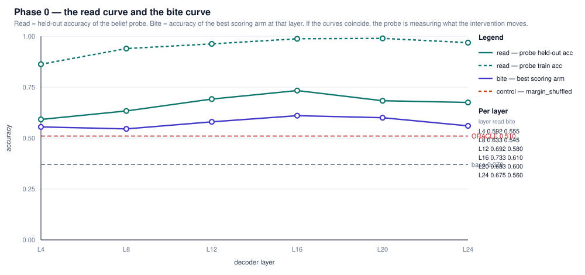
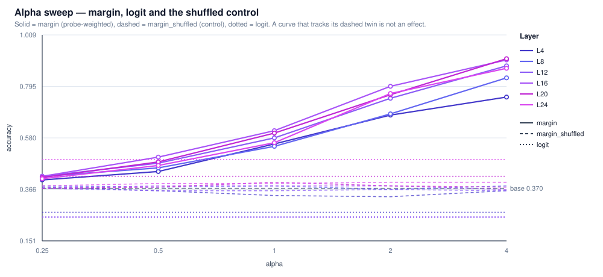
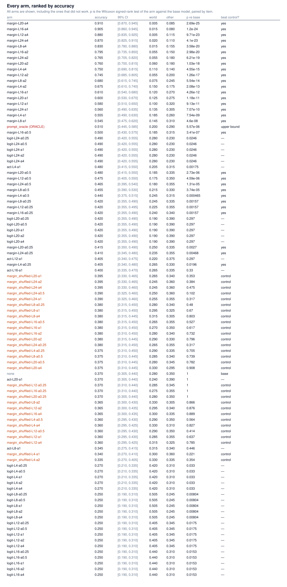

# belief-margin-decoding

**Can a training-free, decoder-level intervention on a partner belief recover what simply *telling* the model the belief recovers — and if it cannot, is the reason that the belief is not linearly encoded, or that it is encoded but not used?**

This repository answers that question with a **falsification matrix** — not with a method that is
presented as working. The matrix is designed so that a negative result is a publishable result, and
so that any positive result has to beat a matched control before it counts.

<!-- HEADLINE -->

---

## The measured result

> **The partner belief is strongly linearly decodable from the model's own activations, and no
> intervention we tested turned that into a usable change in the model's answers.**
>
> | | measured | reference |
> |---|---|---|
> | base model | 0.370 | chance 0.333 (p = 0.29 — **at chance**) |
> | `prompt_oracle` (ORACLE, upper bound) | 0.510 | p = 2.6 × 10⁻⁷ vs chance |
> | belief probe, out-of-fold 3-way ranking at L16 | **0.720** | shuffled control 0.375, p = 2.0 × 10⁻¹¹ |
> | activation steering at L4 (the best forward-pass arm) | 0.480 | p = 0.00175 vs base |
> | ...vs a **matched random direction** at L4 | 0.430 | paired p = **0.151 — not significant** |
> | ...vs the **sign-flipped** belief direction at L4 | 0.380 | paired p = 0.0037 |

The probe works. The intervention does not: the one forward-pass effect is **directional but not
shown to be belief-specific**, and it appears at layer 4, which is exactly where the belief
*cannot* be read.

Two findings from this phase matter beyond the headline:

- **The read and bite curves are inverted.** The belief reads best at layer 16 (0.720) and steers
  nothing there; the only layer where steering does anything is layer 4, where the probe has no
  signal at all (0.420, p = 0.55).
- **A score-level belief-margin intervention does not make the model use the belief; it makes the
  probe pick the answer.** Its out-of-fold accuracy converges onto the probe's own accuracy
  (0.720 at L16, 0.695 at L20) as α grows, and the large numbers in the matrix summary
  (`margin-L20-a4 = 0.910`) are **in-sample leakage**. This is why the mechanism that "beats" the
  oracle is not evidence of anything.

Full numbers, controls, timings, and an explicit **"what was not run"** section are in
[`results/RESULTS.md`](results/RESULTS.md).

---

## What this is

A frozen LLM is asked a three-agent Theory-of-Mind question. In every item exactly one of the three
agents holds the belief that matches reality, and the protagonist never does. That gives a question
with **two distinguishable error modes**:

| error mode | meaning |
|---|---|
| `world` | the model answered with the **true** location — it ignored whose belief was being asked about |
| `other` | the model answered with the **third agent's** belief — it attributed the belief to the wrong agent |

The method under test is the exact mechanism from
[`hwilner/llm-self-detoxifier`](https://github.com/hwilner/llm-self-detoxifier): a closed-form
Fisher-LDA subspace over hidden states, a signed margin, and a re-weighting of the output
distribution. The transplant is from **toxicity space** to **partner-belief space**.

No training. No gradients. No partner model at deployment. One forward pass per candidate.

## The six arms

| arm | what it does | what it is for |
|---|---|---|
| `none` | the frozen model | the baseline |
| `prompt_oracle` | states the belief **outright** in the prompt | the **upper bound** on prompt-level belief injection. Uses ground truth a deployed system would not have, and is labelled ORACLE everywhere it appears |
| `act` | activation steering along the fitted belief direction at layer *L* | a forward-pass intervention at the representation |
| `margin` | re-weights the candidate scores by the standardised probe margin | SASA's mechanism exactly: the decision is made on a belief-consistency margin |
| `logit` | biases the candidate logits via the Gram trick | an intervention at the output, computed without materialising the vocabulary |
| `margin_shuffled` | `margin`, with the probe fitted on **shuffled labels** | **the mandatory control.** An arm that does not beat its shuffled twin has no effect |

## The three questions the matrix answers

1. **Is the belief linearly encoded?** — the *read* curve: held-out probe accuracy per layer.
2. **Does any intervention on it change the answer?** — the *bite* curve: arm accuracy per layer.
3. **Is the effect specific to the belief, or is it generic confidence steering?** — the comparison
   against `margin_shuffled` (and, for the activation arms, against a matched random direction).

If the best-reading layer is not the best-biting layer, that is the interesting finding: the signal
is present but unused, or present and used, and the probe cannot tell you which.

## The two curves







The concept figure is in [`docs/figures/concept_figure.svg`](docs/figures/concept_figure.svg).

## Install and run

```bash
git clone https://github.com/hwilner/belief-margin-decoding.git
cd belief-margin-decoding

python -m venv .venv && source .venv/bin/activate

# macOS / Apple Silicon: the default PyPI wheel is already MPS-capable.
pip install -r requirements-dev.txt && pip install -e .

pytest -q                        # 47 tests, CPU only, no model download
python tools/check_integrity.py  # checks that can fail
```

**On Linux CI**, install CPU-only torch *first* — the default wheel bundles CUDA and would pull
several gigabytes onto the runner for nothing:

```bash
pip install --index-url https://download.pytorch.org/whl/cpu torch
```

### Reproducing the reported run

```bash
python src/run_phase0.py --n-items 200 --layers 4,8,12,16,20,24 \
    --act-alphas 1.0 --score-alphas 0.25,0.5,1.0,2.0,4.0 --out-dir results
```

The run is **resumable**: the expensive base pass is cached to `results/base_cache.npz` (keyed by
model, item count, seed and layers) and every `act` arm writes its own JSON as it completes, so a
killed run continues instead of starting over.

The matched random-direction and sign-flip controls for the activation arms:

```bash
python src/run_controls.py --layer 4 --alpha 1.0 --n-items 200 --out-dir results/controls
```

The leakage-controlled analysis — the matrix summary's scoring arms are evaluated in-sample, so
this re-does them with the split at the level of *items*, 5-fold cross-validated:

```bash
python tools/analyze_heldout.py
```

Every statistic can be recomputed from the stored per-item predictions, without a model:

```bash
python tools/recompute_stats.py
```

## Layout

```
docs/INTRODUCTION.md           the claim and its caveats, up front
docs/EXTENDED_INTRODUCTION.md  the argument, for a reader with no background
docs/METHODS.md                Done / Intended / Undecided, with selection rules
docs/PROJECT.md                atomic task table + the pre-registered publication gate
docs/ROADMAP.md                phases, each with its principal failure mode
docs/API_REFERENCE.md
docs/figures/
src/bmd/                       the library
src/run_phase0.py              the matrix runner
src/run_controls.py            the matched random-direction / sign-flip controls
results/RESULTS.md             what was measured — and what was not
results/ablation/*.json        one file per arm
tests/                         47 tests, CPU only
tools/check_integrity.py       checks that can fail
tools/make_phase0_figures.py   SVG figures and markdown tables from the summary JSON
```

## Rules this repository follows

- **Every behaviour change has a test.**
- **Negative results are reported in full**, with the same prominence as positive ones.
- **Pre-registered thresholds are not adjusted after the fact.** They live in `docs/METHODS.md` and
  the publication gate in `docs/PROJECT.md` §9.
- **Every mechanism that changes the forward pass ships a matched control.** Without it, a positive
  result is indistinguishable from generic confidence steering.
- **Non-parametric statistics by default** — Wilcoxon signed-rank on paired outcomes, bootstrap CIs
  resampled at the item level; the t-test is secondary and labelled as such.
- **A utility floor** (MAUVE ≥ 0.90, ΔPPL ≤ +1) applies to anything that changes generation.

## The publication gate

The repository started **private**. It is flipped to **public** only when all four conditions in
`docs/PROJECT.md` §9 hold: at least 50 % of the code tasks and of the results tasks are done,
`results/RESULTS.md` reports at least one fully measured arm *including the ones that failed*, and
CI is green on `main`. The gate was fixed before the first measurement and is not renegotiated.

## Licence

MIT. See [`LICENSE`](LICENSE).
