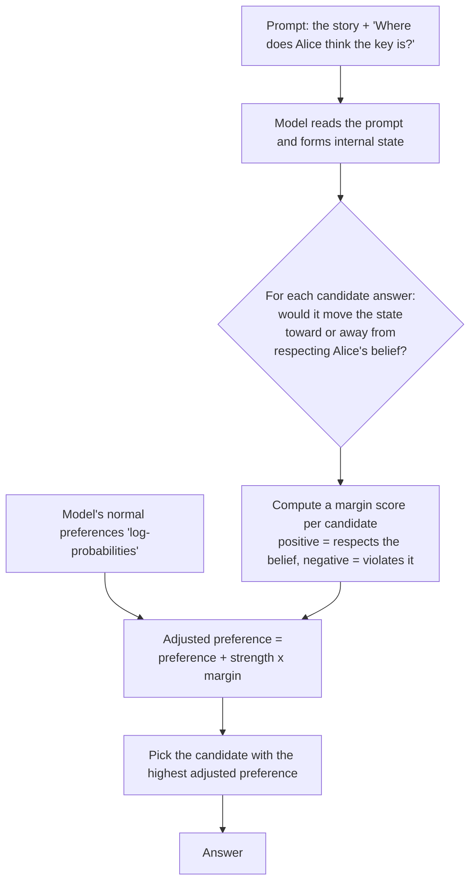
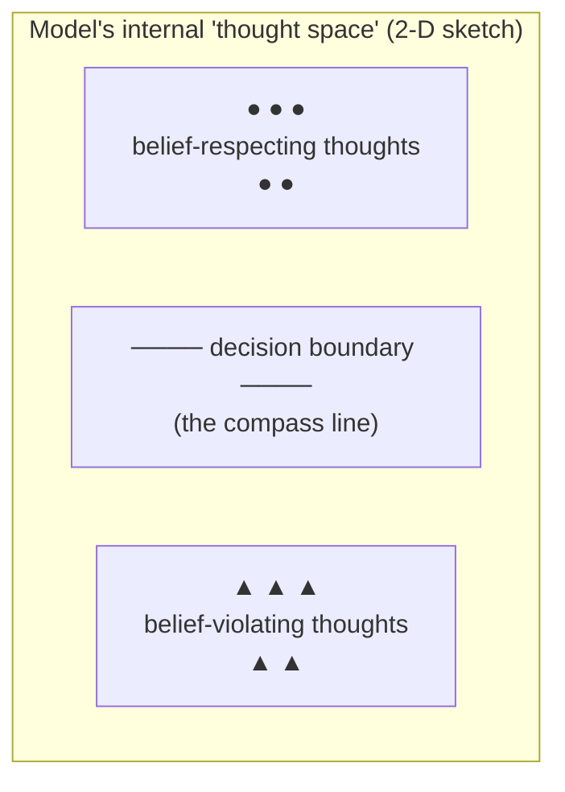

# Belief-Margin Decoding for Everyone: A Zero-Background Introduction

This guide assumes **no machine-learning background** and no math beyond arithmetic. Every technical
idea is introduced the same way: first a tiny example with real numbers you can check by hand, then
the intuition, then the notation as shorthand for the procedure you just saw.

If you know how to use a chatbot, you can understand how this project tries to stop a chatbot from
answering about a person in a way that ignores what that person actually believes.

---

## 1. What's the problem?

Suppose you tell a chatbot:

> "While Alice was away, Bruno moved the key to the bed. Before that, the key had been in the
> drawer. Carmen was told the key was in the toolbox."

Then you ask:

> "Where does Alice think the key is?"

There are three locations in the story, and only one of them is what **Alice** believes:

| Location | What it is |
|---|---|
| the **drawer** | where the key was originally — and therefore what Alice still believes, because she was away and did not see the move |
| the **bed** | where the key actually is now — what **Bruno** believes, since he moved it |
| the **toolbox** | where Carmen thinks it is, because she was told so |

The right answer is **the drawer**. Alice was away. She never saw the move. From where she stands,
the key is still in the drawer.

But a chatbot can easily answer **the bed**. The bed is where the key *actually is*. The chatbot
knows this — it is right there in the text. Answering "the bed" means the chatbot answered the
question *"where is the key?"* instead of the question *"where does Alice think the key is?"*.

**The problem, in one sentence:** language models answer questions about the world instead of
questions about *people's beliefs about the world*, and nothing in their training makes them
prefer the second.

There is a family of research papers that all try to fix this. Almost all of them fix it the same
way: **work out what the partner believes, and put that belief somewhere the model can see.**

Usually that means writing the belief into the prompt ("Note: Alice believes the key is in the
drawer."). Sometimes it means training a reward model on the belief and reinforcement-learning a
policy against it — which needs GPUs, a training pipeline, and a model big enough to be worth it.

This project asks a different question:

> **What if the belief went into the *decoder* instead of the *prompt*?**

---

## 2. The key idea in one image: a compass inside the model

Imagine the model is a person reading the story and forming an impression at every word.

The belief about Alice lives *inside* the model, as a pattern in its internal numbers — much as
SASA (this project's sibling, the LLM self-detoxifier) showed that *toxicity* lives inside the
model as a pattern in its internal numbers. The model learned from its training data that "slur"
and "insult" have a shape; it learned the same way that "Alice believes the drawer" has a shape.

So the plan is:

1. **Find** that internal shape and compress it into a **belief compass** — a direction in the
   model's internal space that points toward "belief-consistent" and away from "belief-violating".
2. At every word it is about to write, **check the compass**: "if I write this word, does it move
   the text toward or away from respecting Alice's belief?"
3. **Nudge** its own preferences — gently, so the writing still sounds natural.

No second AI. No training. No extra model at inference time.

*The figure shows the whole loop: prompt → hidden state → margin to the belief boundary → adjusted
scores → a more belief-consistent answer.*

### A tiny example you can check by hand

Suppose the model's internal "thoughts" are just two numbers, and we recorded:

- Belief-respecting thoughts: `(1, 1)`, `(2, 1)`, `(1, 2)` → center at **(1.33, 1.33)**
- Belief-violating thoughts: `(4, 3)`, `(5, 4)`, `(4, 4)` → center at **(4.33, 3.67)**

Draw the straight line halfway between the two centers. That line is the compass. (The real method
also accounts for how *spread out* each cloud is — it models each cloud as a bell curve, a
**Gaussian** — and then the best straight boundary has a direct closed-form formula, no training
loop. In high dimensions the flat boundary is a **hyperplane**, and the recipe is essentially
Fisher's linear discriminant.)

Continue the example. Suppose the model's current thought is `(2, 2)`. How far is it from the
boundary, and on which side? Project onto the direction between the centers — concretely, subtract
the boundary's midpoint and take a **dot product** (multiply matching entries, then add) with the
compass direction `w`:

- margin = w·(thought − midpoint). Positive = respects the belief, negative = violates it; bigger
  magnitude = deeper in that territory.

That signed distance is the **margin** — how strongly the text is on one side or the other.

Now imagine the model is choosing between three candidate answers, with raw preference scores
(**log-probabilities**) `2.0`, `1.5`, `3.0`:

- "the drawer" → `2.0`
- "the bed" → `1.5`
- "the toolbox" → `3.0`

Normally it would favour "the toolbox" (3.0). The compass asks: how much would each answer move
the text toward or away from respecting Alice's belief? Say the margins come out `+0.8`, `+0.2`,
`−1.5`, and the strength dial is `alpha = 1.0`:

- adjusted score = original + alpha × margin:
  - the drawer: 2.0 + 0.8 = **2.8**
  - the bed: 1.5 + 0.2 = **1.7**
  - the toolbox: 3.0 − 1.5 = **1.5**

"the toolbox" drops from first place to last. The model then turns the adjusted scores into
probabilities by exponentiating and dividing by the total (the recipe called **softmax** — the same
procedure that makes `e^2.8 ≈ 16.4`, `e^1.7 ≈ 5.5`, `e^1.5 ≈ 4.5`, `e^1.5 ≈ 4.5`; total ≈ 30.9, so
"the drawer" gets about 53% of the probability) and picks one.

The dial `alpha` controls how hard the compass pushes. At `alpha = 0` nothing happens, and the
method is exactly the base model — which is why the base model is always one of the arms in the
matrix.

---

## 3. The four ideas, recapped

1. **Dot product** — multiply two lists entry-by-entry and add. It measures alignment, and here it
   asks "how far along the belief direction is the current thought?"
2. **Gaussian ("bell curve")** — describe a cloud of points by its center and spread; each class of
   thoughts is modelled as a bell curve.
3. **Hyperplane** — a flat boundary slicing the space in two; given two bell curves, the best
   boundary has a direct formula.
4. **Softmax** — exponentiate scores, divide by the total: probabilities that sum to 1.

---

## 4. What "belief-respecting" and "belief-violating" mean here, side by side

For the story above, the three candidate answers and their labels are:

| Candidate answer | Label | Why |
|---|---|---|
| "the drawer" | **respecting** | Alice still believes the key was never moved |
| "the bed" | violating | that is where the key *really* is, but not what Alice believes |
| "the toolbox" | violating | that is what *Carmen* believes; the model attributed the wrong agent's belief |

Two distinct ways to be wrong, and they are worth separating because they have different fixes:

- **Perspective-blind** ("the bed"): the model answered the world instead of the person. A fix
  must teach it that *whose* question it is answering.
- **Wrong-agent** ("the toolbox"): the model found *a* belief in the story and attached it to the
  wrong person. A fix must teach it *which* agent.

This repository reports those two error rates separately, always, in every table.

---

## 5. What this repository does **not** do

Naming what a project does not do is part of what it does. This one:

- **does not train anything.** The only fitted object is one vector and one number, obtained by
  solving a linear system. No gradient steps, no fine-tuning, no reinforcement learning, no
  reward model.
- **does not use a second model.** The partner-belief statement is ground truth in the Phase-0
  experiment, and the belief *subspace* is read out of the same frozen model that is being
  steered. A deployed system would need an estimator, and that estimator is **Phase 1 work, not
  done here**.
- **does not claim to beat prompting.** One arm of the matrix states the belief *out loud* in the
  prompt using ground truth — an **oracle** upper bound. If the training-free decoder cannot
  match an oracle prompt on a task, that is a fact about the task, not a failure of the method.
- **does not report a single headline number.** It reports a *matrix*, because the interesting
  question is not "does it work" but "does it work, **where**, and **is the effect actually about
  belief**".
- **does not include the literature's other mechanism.** Partner beliefs are currently injected
  into prompts, into rewards, or into triggers. Those are prior work, and the closest of them are
  cited in `docs/METHODS.md`; this repository tests the *decoder-level* route.

---

## 6. How to read the results

The results live in [`../results/RESULTS.md`](../results/RESULTS.md). Three things to know before
you read them.

**First, there are two curves, and they are not the same curve.**

- The **read curve**: for each layer, how accurately can a simple linear probe tell a
  belief-respecting continuation from a belief-violating one? This says *where the information
  is*.
- The **bite curve**: for each layer, how much does intervening at that layer change the model's
  answers? This says *where the information can be used*.

These can disagree, and that disagreement is the point. A probe might read the belief accurately
at layer 8 and yet intervening at layer 8 might do nothing, because by layer 8 the information has
not yet reached the part of the network that produces the answer.

**Second, every table has a control.** The `margin_shuffled` arm repeats the whole margin
intervention using a subspace fitted on **randomly shuffled labels**. If the shuffled arm does as
well as the real one, then the real arm was not measuring belief at all — it was measuring generic
confidence. Treat any arm that does not beat its shuffled control as **no effect**.

**Third, a null result is a result.** The Phase-0 matrix is designed so that "belief steering does
not work at this model scale, and here is the layer-by-layer reason" is a complete, publishable
outcome. The thresholds were fixed in `docs/PROJECT.md` before the first run and are not adjusted
afterwards.

---

## 7. Where to go next

| You want to… | Go to |
|---|---|
| understand the algorithm and the open design choices | [`METHODS.md`](METHODS.md) |
| see what was measured, including what failed | [`../results/RESULTS.md`](../results/RESULTS.md) |
| see the task list and the publication gate | [`PROJECT.md`](PROJECT.md) |
| use the code | [`API_REFERENCE.md`](API_REFERENCE.md) |
| see the phases ahead | [`ROADMAP.md`](ROADMAP.md) |
