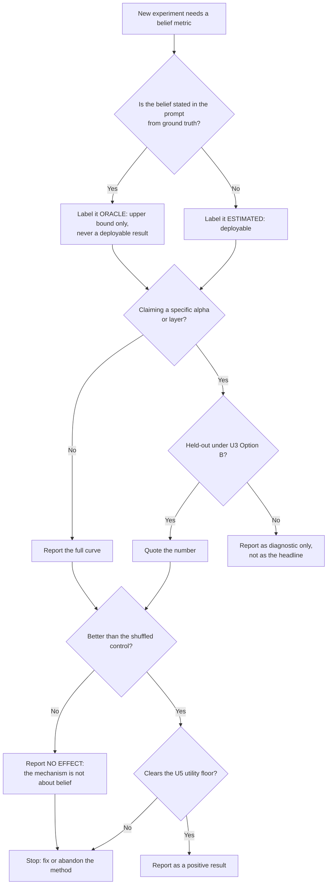

# Methods: Done, Intended, and Undecided

This document records the project's methodological state: what is implemented and tested, what is
planned (and why, plus how each plan could fail), and which design choices remain open with the
rule we will use to resolve them. It complements [`EXTENDED_INTRODUCTION.md`](EXTENDED_INTRODUCTION.md)
(what the method means) and [`../results/RESULTS.md`](../results/RESULTS.md) (what it did).

The task IDs in brackets (`C1`, `D4`, …) refer to [`PROJECT.md`](PROJECT.md).

---

## 0. What this repository is and is not claiming

**This repository does not claim to have discovered the probe-versus-causation gap.** That
phenomenon is established. What it establishes, for a *partner belief* target, at the *logit*
level, under *full generation*:

| Established prior art | What it showed | What it did **not** do |
|---|---|---|
| arXiv `2609.18080` "Decodability is Not Causality" | probe-accurate features need not be the causally used ones | target was truthfulness/deception, not a partner belief |
| arXiv `2605.24583` effective-rank audit | "singular-value order is not causal order"; validate causally per family | safety/alignment subspaces, not social |
| arXiv `2607.22646` "Extracting Algorithms in Pre-trained LLMs" | in a *belief-dominated* HMM, probe R² is high early while patching fails | synthetic HMM; no language model, no prompt oracle |
| arXiv `2606.14040` | geometrically near-identical top-PC vs causally divergent subspaces | SAE scaffolding, not belief steering |
| TrustNLP 2026 `2026.trustnlp-main.12` | probes detect task *format*, not reasoning mode | format confound, not social latent |
| Springer 2026 ch. `10.1007/978-3-032-30860-3_9` | probe-identified neurons do not change deceptive behaviour | deception, not partner belief |
| Electronics 2026 "Safety Bifurcation Point" | late layers linearly separable yet causally inert | multimodal safety, not social |
| zhu24o (PMLR v235) | partner belief is linearly decodable; activation intervention did **not** move performance | did not test a logit-level margin or a prompt oracle |
| COSTOM (ACL 2026 `2026.acl-long.421`), arXiv `2502.14171` | ToM steering works — but both **train** | no training-free decoder-level variant |

**The question this repository actually asks** is narrower and, as far as the audit could
establish, unanswered:

> **Can a training-free, decoder-level intervention on a partner belief recover what simply
> *telling* the model the belief recovers — and if it cannot, is the reason that the belief is not
> linearly encoded, or that it is encoded but not used?**

The `prompt_oracle` arm is the pivot: it states the belief in the prompt using ground truth, and is
therefore an **upper bound** on what prompt-level belief injection can buy. Every decoder-level arm
is measured against that bound, not against the base model alone.

A second, sharper gap: the label being steered is **relational** — "does this location match the
one the protagonist believes?" — and every prior dissociation result uses a **property** label
(safety, truthfulness, format, deception) that is a property of the text alone. A relational label
may behave differently under a linear readout, and the repository treats that as an open question
rather than an assumption.

---

## Done

### Synthetic Theory-of-Mind items with exact ground truth `[C1, D2]`

`bmd.data.generate_items(n, seed)` builds a three-agent scene in which every agent's belief about
one object's location is known **by construction**:

| Agent | Role | Belief |
|---|---|---|
| P | was away during the move | the original location |
| C | was told a location | the location it was told |
| O | performed the move | the true location |

Exactly one belief coincides with the world state, so the protagonist is never the mover and
therefore always holds a belief that differs from reality. Clause order is randomised, the two
non-protagonist clauses are independent, and the option order is a random permutation — so
neither "first location mentioned" nor "last location mentioned" is a winning strategy, and the
"location in the clause that names the protagonist" heuristic points at the **world** location
(a wrong answer). All locations are single nouns so that every candidate continuation has the same
token shape and likelihood comparisons are not confounded by length.

Determinism is from a seeded `random.Random`, so results are reproducible across machines and
Python versions.

### Base-model answer collection and automatic labelling `[C2, D3]`

For each item the three candidate continuations (`" drawer."`, `" bed."`, `" toolbox."`) are scored
by total log-probability under the frozen model, using a **shared prefix KV cache** so the prompt is
prefilled once per item. Each `(item, candidate)` pair inherits a label: `1` if the candidate names
the protagonist's believed location, `0` otherwise. Labels are therefore exact, not heuristic, and
cost no annotation.

> **Tokenisation boundary.** The candidate ids are taken from the joint tokenisation of
> `prompt + candidate` when the prompt tokenisation is a prefix of it (exact), and from the
> standalone tokenisation otherwise (approximate). The exact rate is measured and reported in
> `results/RESULTS.md` rather than assumed; it was 1.00 in the recorded run.

### Per-layer hidden-state extraction `[C3, D3]`

`bmd.model.extract_states` returns the hidden state at the last token of each text for a chosen
layer, gathered by attention-mask length rather than by assuming right padding.

### Closed-form belief subspace `[C4, D4]`

`bmd.subspace.fit_subspace` fits a **shrinkage Fisher linear discriminant** in closed form: a
single linear solve for a direction `w` and a bias `b`. This is the same estimator family the
SASA self-detoxification project uses for *toxicity* space, transplanted here to
*belief-consistency* space. No gradient steps, no learned parameters beyond `w` and `b`.

Two alternatives are implemented and are a **pre-registered** choice (see U1):

- `kind="logreg"` — L2-regularised logistic regression, fitted by full-batch gradient descent.
- `kind="mlp"` — one-hidden-layer probe trained with torch on CPU. The MLP boundary is expressed as
  a linear read-out for margin computation, which makes it an *approximation* of the MLP boundary,
  and this is stated wherever it is used.

A fitted subspace carries `train_acc` and `heldout_acc` from a deterministic 80/20 index split.
**These are preconditions, not decorations:** a subspace whose held-out readout is at chance cannot
support a belief claim, and the repository reports that as a result.

> **Margin normalisation.** `bmd.subspace.normalize_margins` standardises margins to zero mean and
> unit variance before they are scaled by `alpha`. This is not cosmetic: the feasibility pilot
> measured `||w|| ≈ 1.0e4` for a separable fit, which makes any hand-picked `alpha` meaningless.
> Standardising decouples intervention strength from the arbitrary scale of the fitted direction.

### The six intervention mechanisms `[C5, D5]`

| Mechanism | What it does | Needs a re-run? |
|---|---|---|
| `none` | base model, no intervention | no |
| `prompt_oracle` | the partner's belief is **stated in the prompt** using ground truth | yes (different prompt) |
| `act` | add `alpha · direction` to the hidden state at one layer | yes |
| `margin` | add `alpha · margin(candidate)` to each candidate's score | no — cached |
| `logit` | add `alpha · LMHead(norm(direction))` to the logits | no — cached |
| `margin_shuffled` | **control**: the margin intervention with a subspace fitted on shuffled labels | no — cached |

`act` normalises the direction to unit length and scales it by the mean hidden-state norm at that
layer, so that `alpha` means the same thing at every depth.

The `logit` mechanism uses the identity `logits @ u = h_norm @ (WᵀW) @ n` with `W` the language-model
head and `n` the RMSNorm-scaled direction. This avoids caching a full vocabulary logit vector per
candidate. `WᵀW` is computed in float32 and chunked over the vocabulary — casting the full
`(vocab, d)` head to float64 allocates ~1.1 GB and OOMs a 3 GB machine. That was a real bug caught
by the pilot.

### The two curves `[C6, D7]`

- **Read curve** — held-out probe accuracy per layer: *where the belief is linearly readable*.
- **Bite curve** — change in accuracy per layer and mechanism: *where the belief can be used*.

`bmd.matrix.run_matrix` computes both and writes one JSON file per arm to
`results/ablation/<arm-label>.json`, plus a combined `results/phase0_summary.json`.

### Fluency guard `[C7, D6]` — **specified, not yet implemented**

Two guards are **specified** and are **not yet implemented**. They are recorded here so that the
thresholds are fixed before they are first applied, which is the whole point of a pre-registration:

- **ΔPPL** — perplexity of the steered continuation relative to the unsteered one, with a
  pre-registered ceiling of **+1.0**.
- **MAUVE** — distributional similarity between steered and unsteered generations on identical
  prompts, with a pre-registered floor of **0.90**.

A configuration that fails the floor fails the claim, and the failure is reported rather than
tuned around.

> **Why they are not in the Phase-0 numbers.** The Phase-0 arms answer a multiple-choice question
> by scoring three fixed candidate continuations. They do not produce free-form text, so there is
> nothing for MAUVE or ΔPPL to score — the metrics do not apply to this measurement. Reporting a
> ΔPPL of 0.0 for a method that never generated text would be a number with no meaning. The guard
> belongs to the first arm that *does* generate text, and it is implemented there, not retro-fitted
> here. Until then `docs/PROJECT.md` keeps task `C7` open.

### Matched controls for the activation arms `[D7]`

The matrix's `margin_shuffled` arm controls the *scoring* mechanisms. The `act` mechanism changes
the forward pass and had no matched control inside the matrix, which is a real weakness: an
activation-steering arm that "helps" is indistinguishable from generic confidence steering unless
something of the same magnitude, in the same layer, is shown *not* to help.

`src/run_controls.py` supplies the two standard controls at a chosen layer, matched in direction
norm, layer and `alpha`:

| control | direction | what it rules out |
|---|---|---|
| `act_random` | uniformly random unit direction | that *any* perturbation of the residual stream at that layer helps |
| `act_reversed` | the negation of the fitted belief direction | that the effect is a generic confidence effect rather than a directional one |

These are run after the matrix, at the layer the matrix identified as most promising, and are
reported with the same statistics as every other arm.

### Statistics `[D6]`

Headline comparisons use **non-parametric** statistics by default: Wilcoxon signed-rank on paired
per-item outcomes, with a percentile bootstrap CI resampled at the **item** level (never the token
level). The paired test has a hand-rolled tie-corrected normal-approximation fallback when SciPy is
unavailable, and returns `p = 1.0` for identical samples rather than raising.

> **The fallback is tested against the exact test.** It only runs where SciPy is absent, which is
> exactly where nobody can check it, so the CI suite asserts that it agrees with
> `scipy.stats.wilcoxon` on samples of the size used here.

### The split must be at the level of the item `[D6]`

A probe fitted on (item, candidate) pairs and evaluated on those same pairs scores its own training
data. The Phase-0 matrix summary was produced that way, and the resulting `margin-L20-a4 = 0.910`
is largely memorisation: the out-of-fold value for the same arm is 0.695.

**The rule, therefore, is that every reported accuracy for a probe-derived mechanism is
cross-validated over *items*.** The probe may be fitted on the pairs of the training items; it may
never be evaluated on a pair of an item it was trained on. `tools/analyze_heldout.py` does this
with 5-fold cross-validation over items, so every item is scored by a probe that never saw it, and
the bootstrap resamples over all 200 items.

The statistic to report for a probe that must *choose between* candidates is the **3-way ranking
accuracy**, not the pair-wise accuracy: the pair-wise question ("is the margin above zero for the
belief-consistent candidate?") has a trivial baseline of 2/3, because two of an item's three
candidates are negatives. Both are reported.

### Resume-ability

The expensive base pass is cached to `results/base_cache.npz`, keyed by
`(model, n_items, seed, layers)`. Each `act` arm writes its own JSON as it completes and is
skipped on a restart. A killed run resumes instead of starting over.

---

## Intended

Each roadmap item is tracked in [`PROJECT.md`](PROJECT.md); rationale and principal failure mode
are listed here.

1. **A frozen belief *estimator* to replace the oracle.**
   *Rationale:* the Phase-0 `prompt_oracle` arm uses ground truth a deployed system would not have.
   The decoder-level method is only interesting if it works with an **estimated** belief, and the
   estimator is where the real difficulty lives.
   *Failure mode:* the estimator's belief is wrong often enough that the decoder amplifies errors.
   That is precisely what the calibration gate (item 3) is meant to survive.

2. **Second-order belief subspace** — a separate subspace for *what the partner believes about me*,
   composed with the first-order one. This is the `TSM-MA` multi-attribute composition left open in
   the SASA roadmap, repurposed from multi-attribute toxicity to social reasoning.
   *Failure mode:* the two subspaces are near-collinear, so composition is degenerate.

3. **Confidence-gated `alpha`** — scale `alpha` by the estimator's own confidence, so the decoder
   pushes hard when the belief is confident and backs off when it is not.
   *Failure mode:* the confidence is uncalibrated, so the gate is decorative. Calibration must be
   **measured**, not assumed.

4. **Real benchmark loaders** (`Hi-ToM/Hi-ToM_Dataset`, BigToM) to check that the synthetic task's
   conclusions transfer to a published benchmark.
   *Failure mode:* the real benchmarks have different answer formats and scoring conventions, and
   the synthetic conclusions may not survive the transfer.

5. **Free-form generation** rather than scored multiple choice. The Phase-0 task scores three
   fixed candidates; a deployed system must produce free text.
   *Failure mode:* free generation removes the likelihood comparison that makes the task well posed,
   and the margin must then be computed per token rather than per candidate — which is where
   SASA's own next-state approximation gets expensive.

6. **Per-token margin decoding at inference** (the SASA loop proper), with the top-k restriction
   that the feasibility pilot showed is mandatory.
   *Failure mode:* the pilot measured that full-vocabulary margin computation costs **1298 ms per
   token** on CPU against **0.17 ms** for top-64 — a 64-token reply would carry **83 seconds** of
   overhead versus **11 milliseconds**. Full-vocabulary margin decoding is not viable on a laptop,
   and the top-k restriction is what makes it possible at all.

7. **Fluency arms over free generation.** The ΔPPL and MAUVE guards need generations, which the
   scored-multiple-choice Phase-0 task does not produce.
   *Failure mode:* fluency on multiple-choice is vacuous; the guard is only meaningful once item 5
   lands.

---

## Undecided choices

For each open choice we list **both options** and a **selection rule**. A choice is resolved only
when the rule is applied and the outcome recorded here.

### U1 — Subspace readout: linear or nonlinear?

- **Option A — linear** (`kind="lda"`, or `kind="logreg"`). Pros: closed form, milliseconds,
  interpretable direction, matches the SASA estimator family. Cons: belief-consistency is a
  *relational* property ("does this location match the one the protagonist believes?"), and a
  linear readout of a joint (story, option) representation may not be able to express a comparison.
- **Option B — nonlinear** (`kind="mlp"`). Pros: can express "does the option's location match the
  location tagged as the protagonist's belief?". Cons: more parameters, needs more labelled data
  than Phase 0 has, and the MLP boundary is only *approximately* linear for margin computation.

> **Selection rule.** Fit both on the same data. **A choice is admissible only if its held-out
> readout accuracy reaches 0.70**; otherwise the belief signal is not present at that depth and the
> repository reports the absence rather than proceeding. Among admissible choices, prefer the one
> with the higher held-out accuracy; break ties toward Option A (simpler, and the mechanism the
> method is built around). The Phase-0 run uses Option A because it is the default and because
> Phase 0's purpose is to test the *mechanism*, not to maximise the readout.

### U2 — Which intervention mechanism is the method?

- **Option A — margin decoding** (`margin`). Pros: it is the SASA mechanism, it acts per candidate,
  and the pilot showed it is computationally free once the forward pass is cached. Cons: it needs a
  subspace whose readout is good, and it inherits the relation between probe quality and
  intervention quality.
- **Option B — activation steering** (`act`). Pros: it changes the forward pass itself, so it can
  affect representations rather than only the final ranking. Cons: it requires a full re-run per
  configuration (roughly 2.8 s per item on the reference machine), which is what makes the matrix
  expensive; and it is sensitive to the layer at which it is applied.

> **Selection rule.** Both mechanisms are run in Phase 0. The method is **Option A** unless Option B
> produces a larger and *statistically significant* improvement over the `none` arm at the same
> layer, in which case the method becomes Option B. If neither beats `none` significantly, the
> repository reports that as the headline negative result and does not build a decoder.

### U3 — How is `alpha` chosen?

- **Option A — fixed grid**, reported as a sweep. Pros: simple, reproducible, shows the shape of
  the effect. Cons: the best `alpha` is chosen on the same data the result is reported on, which is
  a selection leak.
- **Option B — auto-calibrated** from a held-out split (e.g. the `alpha` that maximises accuracy on
  a 20 % calibration split, applied to the remaining 80 %). Pros: no leak. Cons: halves the
  effective sample size and adds a moving part.

> **Selection rule.** Phase 0 reports the **full grid** with the leak stated plainly, and every
> claim about a specific `alpha` must additionally be re-checked with **Option B** on a held-out
> split. If the grid-best `alpha` does not reproduce under Option B, the claim is not made.

### U4 — Significance test

- **Option A — parametric** (paired t-test on per-item outcomes). Pros: familiar, more power when
  assumptions hold. Cons: outcomes are bounded, skewed and often bimodal; normality is dubious.
- **Option B — non-parametric** (Wilcoxon signed-rank + bootstrap CI resampled at the item level).

> **Selection rule.** **Option B is the default for every headline comparison.** The parametric
> t-test is reported as a secondary check. If the two disagree, both are reported and the
> non-parametric result is trusted. Fixed in advance to prevent test-shopping.

### U5 — Utility floor

- **Option A — MAUVE** between steered and unsteered generations on identical prompts. Pros:
  automatic, corpus-level, sensitive to semantic drift that perplexity misses. Cons: needs a minimum
  sample size; not interpretable per generation.
- **Option B — pairwise win-rate** (head-to-head quality judgement of steered vs. baseline
  continuations). Pros: interpretable per pair; can be human-based. Cons: needs a judge, and judge
  choice is itself a research decision; noisier on small samples.

> **Selection rule.** **MAUVE is the primary utility floor on every full run**; pairwise win-rate is
> reported alongside whenever a judge is available, and is the primary check on any subset covered by
> human spot-checks. **Pre-registered floor, fixed before the full runs: MAUVE(steered vs.
> unsteered) ≥ 0.90, and ΔPPL ≤ +1.0 on WikiText-2.** A configuration that fails the floor fails the
> claim regardless of accuracy gains; the failure is reported, not tuned around, and the thresholds
> are **not** adjusted after results are seen.

### U6 — Layer selection policy

- **Option A — a priori fixed layer.** Pros: no leak; the layer is decided before the run.
- **Option B — post-hoc best layer** (pick the layer that maximised accuracy, then report it).
  Pros: reports the method at its best. Cons: **selection leak** — the reported number is a maximum
  over a search and is optimistically biased.

> **Selection rule.** The per-layer table is always reported in full, so the reader can see the
> whole curve. A **specific layer** may only be quoted as the method's operating point if it was
> fixed **before** the run, or if it survives on a **held-out split** under Option B of U3. The
> post-hoc best layer is reported as a *diagnostic* (it tells us where the signal bites), never as
> the headline.

---

## Evaluation-selection decision flowchart

---

## Standing rules

- Every empirical claim cites a benchmark, a metric choice resolved per this document, and a test.
- Negative or null results are reported, not deleted.
- No changes to `bmd/` behaviour without a corresponding test in `tests/`.
- The Phase-0 thresholds in [`PROJECT.md`](PROJECT.md) §9 and in this document are **fixed before
  the run that uses them** and are not adjusted afterwards.
- A claim about belief steering is void if the arm does not beat its **shuffled-label control**.
